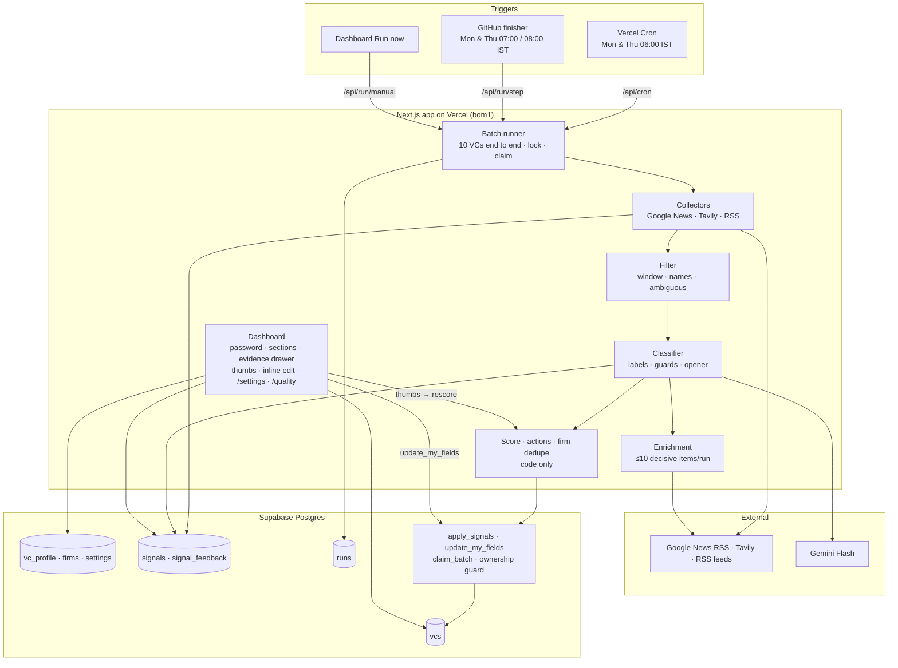

# VC Fundraising Pipeline Intelligence

**What it does.** Twice a week this collects public signals (deals, writing, talks, press) about the 50 VCs on a founder's list, has Gemini label each item, and lets plain code score every VC and pick an action. It writes four system columns of the founder's Supabase `vcs` table (last signal date, summary, follow-up score, recommended action) and never touches the founder's own columns. A password-protected dashboard shows who to contact this week, why, with a source link and a suggested opener, and the proof is one click away.

Live: https://vc-pipeline-zeta.vercel.app (password-protected) · Spec: `docs/SPEC.md` · Decisions where the spec was silent: `docs/DECISIONS.md` · Demo: `docs/DEMO.md` · Acceptance: `docs/ACCEPTANCE.md` · Build status: `docs/STATUS.md`

## Setup

### Free services

| Service | What to do |
|---|---|
| **Supabase** (free) | Create a project. Apply `supabase/migrations/001`–`005` in order (SQL editor, or `supabase db push`). Copy the project URL and the `service_role` key (Project Settings → API Keys). |
| **Google AI Studio** (free) | Create an API key and note the free **Flash** model it offers (this build uses `gemini-3.8-flash`). |
| **Tavily** (free, 1,000 credits/month) | Create an API key. The app stops at `TAVILY_MONTHLY_BUDGET` (default 800). |
| **Vercel** (Hobby) | Import the GitHub repo (framework: Next.js, region `bom1`). Add the environment variables below to Production. `vercel.json` schedules `/api/cron` for 06:00 IST Mon/Thu. |
| **GitHub** | Add the repo secret `CRON_SECRET` for the finisher workflow. CI needs no secrets. |

### Environment variables (`.env.local` locally, Vercel Production in the cloud)

| Variable | Purpose |
|---|---|
| `SUPABASE_URL`, `SUPABASE_SERVICE_ROLE_KEY` | Server-only database access (never sent to the browser) |
| `GEMINI_API_KEY`, `GEMINI_MODEL` | Classifier; `GEMINI_API_KEY_2` is an optional fallback, tried on invalid-key, 401/403 and 429 errors |
| `TAVILY_API_KEY`, `TAVILY_MONTHLY_BUDGET` | Fallback search with a hard monthly cap |
| `CRON_SECRET` | Bearer secret for `/api/cron` (sent by Vercel Cron) and `/api/run/step` (the finisher) |
| `DASHBOARD_PASSWORD`, `SESSION_SECRET` | Dashboard login; 30-day HMAC-signed cookie |
| `SUPABASE_ANON_KEY` | Optional, local only: lets the ownership test prove the anon role can't read `vcs` |

### Database and seed

1. Apply the migrations. `001` is SPEC §7 verbatim; `002`–`005` add the runner helpers, a `claim_batch` fix, the guard's `search_path`, Phase 2 signal fields and the split persona settings.
2. Import `seed/vcs_import_master.csv` into `vcs` (Supabase Table Editor → Import data from CSV).
3. `npm run import-seed` loads the firms, the two persona settings and the 50 investor profiles. It refuses to run until `vcs` has rows.

### Local commands

| Command | What it does |
|---|---|
| `npm run dev` / `npm run build` | Next.js app |
| `npm test` | Unit tests plus the recall test (replays recorded Gemini responses, so no keys needed) |
| `npm run test:db` | Ownership integration test against the Supabase project in `.env.local` |
| `npm run test:recall:live` / `test:recall:record` | Recall test against live Gemini; re-record after any classifier prompt, schema or fixture change |
| `npm run step [-- --force]` | Run the pipeline locally until the run finishes |
| `npm run rescore` | Recompute all scores and actions from stored signals after a constants change (no fetching) |
| `npm run settings -- --target-space "…" --my-product "…"` | Change either setting (also on `/settings`); queues recent signals for reclassification |
| `npm run eval` | Precision/recall on hand labels, with tune/test split |
| `npm run ranking:export` / `ranking:calibrate` | §12.3 ranking review and threshold calibration |
| `npm run diagnose` | Per-VC score diagnosis → `eval/score_diagnosis.md` |
| `node --env-file=.env.local scripts/stress-live.mjs` | Auth, input-fuzzing, concurrency and load checks against the deployed app |

## Where AI is used, and where it deliberately isn't

- **Gemini Flash** reads only each item's headline and ≤300-character snippet. For each item it labels:
  - whether it's about this VC (not a namesake or passing mention);
  - the signal type and subject;
  - a fixed relevance level against the founder's **target space** (core / logistics non-software / adjacent / unrelated);
  - whether the VC backed a competitor of the founder's **product**, with verbatim evidence;
  - the funded company and any role change.

  It also writes a 20-word summary and a one-sentence suggested opener.
- **Code owns everything that must be verifiable and repeatable:**
  - dates (source metadata only) and URLs (collectors only);
  - the window and name filters;
  - the mapping from relevance level to a number;
  - acceptance thresholds, scores, actions, the evidence floor, firm dedupe;
  - every database write.

  Code guards drop competitor flags, company names, and opener names or numbers that aren't literally in the item's text. Openers are never kept on rejected items.
- **The database enforces who owns what.** The pipeline can write only the four system columns (`apply_signals`), dashboard edits only the founder's columns (`update_my_fields`), and a direct `.update()` on `vcs` is refused for the service role. An ownership integration test proves all three against production.

### Evaluation

| Check | Result |
|---|---|
| Golden recall: 6 real deals on frozen fixtures (CI replays recorded Gemini responses) | **6 / 6**; SuperProcure flagged as a competitor (evidence "Unified TMS Platform") |
| Acceptance precision on the test split (gate ≥ 0.80) | **0.95** (recall 0.95; 30 test items) |
| `about_this_vc` precision on the test split (gate ≥ 0.90) | **1.00** (recall 1.00) |
| Type accuracy / relevance-level accuracy (test) | 0.70 / 0.77 |
| Chosen `MIN_CONFIDENCE` / `MIN_RELEVANCE` | **0.7 / 0.** Tuned on the tune split; 0.5–0.7 tie, so the default is kept |
| Ranking-review agreement | **98%** (49/50). Only 2 of 50 VCs were "would contact this week", so the calibration is thin |
| Chosen `REACH` / `WARM` / `HALF_LIFE_DAYS` | **30 / 15 / 20** (`eval/calibration.json`). Contact actions also need the evidence floor |

The eval labels (60 items, 10 not about the VC) and the ranking-review answers were written by the builder (Claude Code) from first principles at the owner's request, not by a human. The classifier's definitions of "about this VC" and "irrelevant" were tightened after seeing errors from both splits, so the test split isn't fully blind to that change. See `docs/DECISIONS.md` #20–22.

## Data and terms of use

- **Stored per item:** headline, a snippet of at most 300 characters (enforced by a database check), the link, the source's own date, and the AI's labels. Full articles are never fetched or stored. Enrichment uses a search API's own ≤300-character excerpt.
- **Sources:** Google News RSS (no key; requests at least 300 ms apart), Tavily search (capped monthly; LinkedIn, X and investor-directory sites are excluded), and the VC's or firm's own RSS feed where one is listed. LinkedIn and X are never scraped.
- **Scope:** only public, professional information about investors in their professional capacity. Data stays in the founder's own Supabase project. The dashboard is password-protected, and the database denies all access to anon and authenticated roles.

## Components Map

## Known limitations

- **Research attribution is mostly firm-level.** Many signals name the firm, not the partner, and are discounted (subject weight 0.7).
- **Google News items are usually headline-only.** About 1% carry a usable snippet. Tavily fills gaps (and enriches decisive items) within a monthly credit cap.
- **Undated results:** about a third of Tavily results have no date; they're scored conservatively, as if 30 days old.
- **Free-tier limits:** Vercel Hobby functions stop at 300 s, so a full run with heavy reclassification can need the GitHub finisher. Gemini free-tier latency (13–70 s per call) dominates run time. Tavily allows 1,000 credits a month (this app stops at 800).
- **Google News RSS is unofficial** and could change or rate-limit without notice.
- **Little target-space activity on this list right now:** no VC has a recent core logistics or supply-chain signal, so no "Reach out" action fires; the evidence floor holds them at Warm. Calibration rests on 2 positive examples and should be redone as data accumulates.
- **Gemini output varies run to run,** even at temperature 0; a VC's score can move between runs on the same evidence.
- **Eval labels and ranking answers came from the builder, not a human** (see above).

## Tooling disclosure

The runtime AI is **Gemini Flash only** (via `@google/genai`); there is no Anthropic or Claude API call anywhere in the app. The project was **built with Claude Code** (Anthropic's coding agent) as the development tool: it wrote the code, tests and docs under the owner's direction and review, and at the owner's request also labelled the eval set and answered the ranking review. Other tools: Next.js, Tailwind, Supabase, Vercel, Vitest, GitHub Actions.
