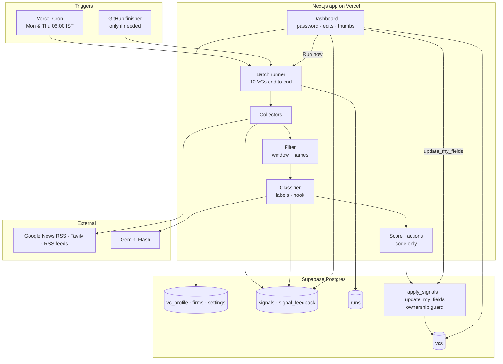

# SPEC: VC Fundraising Pipeline Intelligence

This is the **only** build specification. It replaces `CLAUDE_CODE_BUILD_PROMPT.md` and `BUILD_PROMPT_ADDENDUM_roster_and_momentum.md`. Deferred scope lives in `docs/later/LATER.md`; **do not read or build it unless explicitly told to.**

---

## 0. How to work

- Work phase by phase (section 13). **Stop at the end of every phase**, report against its exit check, and wait for "go".
- When this spec is silent or ambiguous, ask. Do not invent requirements.
- Prefer the simplest implementation that passes the exit check.
- Never weaken a test to make it pass. If a test seems wrong, stop and say why.

## 1. The job

Vikram is a first-time founder raising a Seed round. Twice a week, before he works his pipeline, he opens one screen and within ten seconds knows:

1. which VCs on his list are worth contacting **this week**, and **why**, backed by an observable public signal from the **last 30 days** (something they wrote, said, invested in, or appeared at), with a link and a suggested opening line;
2. which VCs have been quiet, so he doesn't spend energy there.

His Supabase table is already updated when he opens it. The system writes only four columns and never touches his own.

**Design rule:** the LLM reads and labels evidence; plain code decides dates, scores, actions and writes; the database enforces who owns which column.

## 2. Vikram's company (the persona)

Relevance and competitor checks depend on what Vikram sells. The default persona, stored in the `settings` table and editable on the dashboard:

> **Freight procurement and transport management (TMS) SaaS for mid-size Indian manufacturers and shippers.** Automates carrier sourcing, freight auctions, contract rates, shipment tracking and freight-bill audit. Early revenue, raising a USD 1–3M Seed. Relevant themes: freight, trucking, transport procurement, shipper/carrier software, supply-chain visibility, logistics SaaS for manufacturing. Direct competitors: other TMS / freight-procurement platforms for Indian shippers.

Changing the persona resets every in-window signal that reached the classifier to `pending`, so the next run reclassifies them against the new persona (a few extra Gemini calls). Show the current persona in the dashboard header.

## 3. Hard constraints

1. All AI calls use **Gemini Flash** via `@google/genai`; model name from env `GEMINI_MODEL`. **No Anthropic/Claude API anywhere in the app.**
2. Deploy on **Vercel** (Hobby). Data in **Supabase** (free).
3. Only free tiers: Google News RSS (no key), Tavily free plan, Gemini via a Google AI Studio key.
4. The pipeline writes to `vcs` ONLY: `last_signal_date`, `signal_summary`, `follow_up_score`, `recommended_action`.
5. A signal counts only if its **source date** is within the last 30 days (UTC). The window length is a constant (`SIGNAL_WINDOW_DAYS = 30`) that tests can override.
6. Every scored signal has a URL that came from a collector. The LLM never produces URLs, dates, scores or actions.
7. The service-role key never reaches the browser.
8. Store only headline, a snippet of at most 300 characters, and the link. Never fetch or store full articles. Rate-limit Google News politely.

## 4. Stack

Next.js (App Router, TypeScript) · Tailwind · `@supabase/supabase-js` · `@google/genai` · `rss-parser` · `zod` · `vitest`. Ask before adding any other runtime dependency.

## 5. Environment variables (`.env.example`)

```
SUPABASE_URL=
SUPABASE_SERVICE_ROLE_KEY=
GEMINI_API_KEY=
GEMINI_MODEL=                    # the free Flash model shown in Google AI Studio
TAVILY_API_KEY=
TAVILY_MONTHLY_BUDGET=800        # hard stop below the 1,000 free credits
CRON_SECRET=
DASHBOARD_PASSWORD=
SESSION_SECRET=
```

## 6. Repository layout

```
/CLAUDE.md
/docs/SPEC.md                     this file
/docs/later/LATER.md              deferred scope — do not read unless told
/seed/vcs_import_master.csv       50 tracked VCs (Vikram imports via table editor)
/seed/vc_profile_seed.csv         research data for 99 investors
/seed/firms_seed.csv              57 firms with aliases and feeds
/seed/golden_events.json          real, sourced deals for recall tests
/spike/                           Phase 0 throwaway code; nothing imports from here
/eval/labels.jsonl                hand-labelled items (Phase 0)
/eval/fixtures/                   frozen item text for tests
/app ... /lib ... /tests ... /supabase/migrations ... /scripts
/.github/workflows/ci.yml         tests on every push
/.github/workflows/finisher.yml   only if Phase 0 shows it's needed
/vercel.json
/README.md
```

## 7. Database (`supabase/migrations/001_init.sql`)

```sql
-- ===== Vikram's pipeline =====
create table vcs (
  id uuid primary key default gen_random_uuid(),
  -- Vikram-owned
  name text not null,
  firm text not null,
  thesis text,
  status text not null default 'not_contacted'
    check (status in ('not_contacted','awaiting_response','in_conversation','passed')),
  last_contact_date date,
  notes text,
  rss_url text,                              -- a personal feed only, never a firm feed
  -- System-owned (pipeline writes only these four)
  last_signal_date date,
  signal_summary text,
  follow_up_score int check (follow_up_score between 0 and 100),
  recommended_action text
);

-- ===== Research and system state, 1:1 with vcs =====
create table firms (
  firm_key text primary key,
  display_name text not null,
  aliases text[] default '{}',               -- distinctive names only; never generic words (e.g. 'Elevation', 'Prime')
  firm_rss text,
  fund_info_research text
);

create table vc_profile (
  vc_id uuid primary key references vcs(id) on delete cascade,
  firm_key text references firms(firm_key),
  aliases text[] default '{}',
  ambiguous_name boolean default false,
  trust text check (trust in ('A','A-','B','C')),
  tier int,
  research jsonb default '{}',               -- title, verified date, cheque, approach, conflicts, sources
  research_as_of date,
  last_processed_at timestamptz,
  last_fetch_status text check (last_fetch_status in ('ok','partial','failed')),
  appearance_checked_at timestamptz,
  claimed_run uuid,
  claimed_at timestamptz
);

-- ===== Evidence =====
create table signals (
  id bigserial primary key,
  vc_id uuid not null references vcs(id) on delete cascade,
  url text not null,
  url_hash text not null,
  title text not null,
  title_norm text not null,
  snippet text check (char_length(snippet) <= 300),
  source text not null,                      -- google_news | google_news_appearance | tavily | tavily_appearance | person_rss | firm_rss
  published_at timestamptz,                  -- source metadata only; null = undated
  status text not null default 'pending'
    check (status in ('pending','accepted','rejected','unclassified')),
  reject_reason text,
  source_name text,                          -- publisher, e.g. stripped from Google News titles
  date_approx boolean default false,         -- true when only the API's time filter vouches for the date
  subject text check (subject in ('person','firm')),
  signal_type text check (signal_type in ('investment','authored','speaking','press','other','irrelevant')),
  about_this_vc boolean,
  confidence numeric,
  relevance numeric,
  possible_competitor boolean,
  competitor_evidence text,                  -- verbatim phrase from title/snippet describing the funded product
  role_change_hint text,
  event_key text,
  summary text,
  hook text,
  created_at timestamptz default now(),
  unique (vc_id, url_hash),
  unique (vc_id, title_norm)
);
create index on signals (vc_id, status);

-- ===== Feedback (Vikram's thumbs) =====
create table signal_feedback (
  signal_id bigint primary key references signals(id) on delete cascade,
  verdict text not null check (verdict in ('up','down')),
  reason text,
  created_at timestamptz default now()
);

-- ===== Settings =====
create table settings (
  key text primary key,
  value text not null,
  updated_at timestamptz default now()
);

-- ===== Runs (log + lock only) =====
create table runs (
  id uuid primary key default gen_random_uuid(),
  trigger text not null check (trigger in ('cron','github','manual')),
  force boolean default false,
  status text not null default 'running' check (status in ('running','done','partial','failed')),
  started_at timestamptz default now(),
  heartbeat_at timestamptz default now(),
  finished_at timestamptz,
  failed_vc_ids uuid[] default '{}',         -- VCs that errored in THIS run; never retried within it
  tavily_credits int default 0,
  gemini_calls int default 0,
  stats jsonb default '{}',
  errors jsonb default '[]'
);
```

**Ownership (same migration):**

```sql
create or replace function guard_ownership() returns trigger language plpgsql as $$
declare w text := coalesce(current_setting('app.writer', true), '');
begin
  if w = 'pipeline' and
     (new.name, new.firm, new.thesis, new.status, new.last_contact_date, new.notes, new.rss_url)
     is distinct from
     (old.name, old.firm, old.thesis, old.status, old.last_contact_date, old.notes, old.rss_url)
  then raise exception 'pipeline may not modify Vikram-owned columns'; end if;
  if w = 'human' and
     (new.last_signal_date, new.signal_summary, new.follow_up_score, new.recommended_action)
     is distinct from
     (old.last_signal_date, old.signal_summary, old.follow_up_score, old.recommended_action)
  then raise exception 'dashboard edits may not modify system columns'; end if;
  return new;
end $$;

create trigger guard_ownership before update on vcs
for each row execute function guard_ownership();

create or replace function apply_signals(
  p_id uuid, p_last_signal_date date, p_summary text, p_score int, p_action text
) returns void language plpgsql security definer set search_path = public as $$
begin
  perform set_config('app.writer', 'pipeline', true);
  update vcs set last_signal_date = p_last_signal_date, signal_summary = p_summary,
                 follow_up_score = p_score, recommended_action = p_action
   where id = p_id;
end $$;

create or replace function update_my_fields(
  p_id uuid, p_status text, p_last_contact_date date, p_notes text
) returns void language plpgsql security definer set search_path = public as $$
begin
  perform set_config('app.writer', 'human', true);
  update vcs set status = p_status, last_contact_date = p_last_contact_date, notes = p_notes
   where id = p_id;
end $$;

-- Atomic batch claim: two concurrent steps can never take the same VC
create or replace function claim_batch(p_run uuid, p_started timestamptz, p_force boolean, p_failed uuid[], p_n int)
returns setof uuid language plpgsql security definer set search_path = public as $$
begin
  return query
  update vc_profile vp set claimed_run = p_run, claimed_at = now()
   where vp.vc_id in (
     select vc_id from vc_profile
      where (last_processed_at is null or last_processed_at < p_started)
        and not (vc_id = any(p_failed))
        and (p_force or last_processed_at is null or last_processed_at < now() - interval '24 hours')
        and (claimed_at is null or claimed_at < now() - interval '10 minutes' or claimed_run = p_run)
      order by last_processed_at nulls first
      limit p_n
      for update skip locked)
  returning vp.vc_id;
end $$;

do $$ declare t text; begin
  foreach t in array array['vcs','firms','vc_profile','signals','signal_feedback','settings','runs'] loop
    execute format('alter table %I enable row level security', t);
    execute format('revoke all on %I from anon, authenticated', t);
  end loop;
end $$;
revoke update on vcs from service_role;
revoke execute on function apply_signals, update_my_fields, claim_batch from public, anon, authenticated;
grant execute on function apply_signals, update_my_fields, claim_batch to service_role;
```

Vikram can still edit anything in the Supabase table editor (the `postgres` role, untagged, passes the guard).

## 8. Seed import (`scripts/import-seed.ts`)

1. Insert `firms_seed.csv` into `firms` (`firm_key` = slug of `firm`; split `firm_aliases` on `;`).
2. Insert the persona from section 2 into `settings` as `company_profile`.
3. If `vcs` is empty, print: "Import seed/vcs_import_master.csv via the Supabase table editor, then rerun." and exit. (Keeps the initial import a human action.)
4. For each `vcs` row, match `vc_profile_seed.csv` by normalized name + firm and insert `vc_profile` (aliases, ambiguous_name, trust, tier, and the remaining research fields into `research` jsonb). Print unmatched rows; never guess.

## 9. Pipeline

### 9.1 Batch runner (`lib/runner.ts`)

The unit of correctness is **one VC**. Each step processes one batch of up to 10 VCs **end to end**.

`step({ trigger, force })`:

0. **Profiles.** Insert a default `vc_profile` row for any `vcs` row that lacks one (Vikram may add VCs in the table editor at any time); `firm_key` is set by matching `vcs.firm` against `firms` names and aliases, else null.
1. **Lock.** If a run has `status = 'running'` and `heartbeat_at` within 10 minutes, use it; never start a second. If none, create one. A stale running run is marked `failed` and a new one starts.
2. **Claim batch** with the `claim_batch` RPC (10 VCs; atomic, `skip locked`): VCs not processed since the run started, not in `failed_vc_ids`, and, unless `force`, not processed in the last 24 hours. If none remain, finish the run (`partial` if `failed_vc_ids` is non-empty, else `done`) and return `done: true`.
3. **Collect** (9.2) for the batch, concurrency 3.
4. **Filter** (9.3).
5. **Classify** (9.4): one Gemini call for all pending items in the batch (cap 40 items; if more, split into two calls).
6. **Score and write** (9.5, 9.6) for each VC whose items are all classified, via `apply_signals`. Set `last_processed_at = now()` and `last_fetch_status`.
7. Any VC that errors (e.g. Gemini fails after retries) goes into `failed_vc_ids`, is **not written**, and keeps its previous values. Its items stay `pending` for the next run.
8. Update `heartbeat_at`, counters, `stats`. Return `{ runId, done, processed, remaining }`.

**Entry points:**

- `GET /api/cron` (Vercel Cron, `30 0 * * 1,4` = 06:00 IST Mon/Thu): verifies `Bearer CRON_SECRET`, loops `step` until done or 10 s before `maxDuration`.
- `POST /api/run/step` (bearer secret): one step; used by the optional GitHub finisher.
- Dashboard **Run now**: a server action that loops `step({ trigger: 'manual' })`, showing progress, after a confirmation showing estimated Tavily credits.

### 9.2 Collectors

All: 10 s timeout; `url_hash = sha256(normalized url)`; snippet truncated to 300 chars; insert `on conflict do nothing`.

- Google News titles end in ` - Publisher`: strip it into `source_name` **before** computing `title_norm` (lowercase, punctuation stripped, whitespace collapsed), so the same story from Google News and Tavily dedupes.
- Google News RSS descriptions are mostly the headline again plus links. Store a snippet only if it adds text beyond the title; otherwise leave it null.
- Tavily results with no date, returned under the "last month" filter: set `published_at = null`, `date_approx = true`. They are scored as if `SIGNAL_WINDOW_DAYS` old (the most conservative assumption) and shown as "date approx".

| Collector | When | Query / source |
|---|---|---|
| Google News | every run, every VC | `("Name" OR "Alias") ("Firm" OR "Firm alias") when:30d`, `hl=en-IN&gl=IN&ceid=IN:en`; 300 ms between requests |
| Google News, appearances | every run, every VC | `("Name" OR "Alias") (podcast OR panel OR keynote OR summit OR fireside) when:30d` |
| Tavily | only if Google News returned < 2 items for this VC and month-to-date credits < budget | basic search, last month, max 5 results, `"Name" Firm` |
| Tavily, appearances | Monday runs only, the 20 tracked VCs with the best tier, if `appearance_checked_at` older than 6 days and budget allows | `"Name" podcast OR panel OR keynote OR summit` |
| Person RSS | if `vcs.rss_url` set | items within 30 days |
| Firm RSS | if `firms.firm_rss` set | items within 30 days; **firm-level source, not assumed to be about the person** |

**Enrichment (enabled only if the Phase 0 gate says so):** after classification, for the at most 10 accepted items per run that would decide a contact action (rows 5–7 of 9.6) and have no snippet, run one Tavily basic search with the headline as the query, take the matching result's content (≤ 300 chars) and canonical URL, and reclassify those items. About 90 credits a month.

Verify Tavily parameter names against current docs before coding. Count 1 credit per Tavily call into `runs.tavily_credits`.

Set `last_fetch_status`: `ok` if every attempted source succeeded, `partial` if some failed, `failed` if all failed.

### 9.3 Filter (code, before the LLM)

Reject (with `reject_reason`, no LLM call) when:

- `published_at` exists and is older than `SIGNAL_WINDOW_DAYS`;
- neither the name nor any alias appears in title + snippet, **and** neither the firm nor any firm alias appears (person RSS is exempt);
- `ambiguous_name = true` and no firm or firm alias appears in title + snippet.

Undated items pass to the classifier but are never scored; they show as "date unknown".

### 9.4 Classifier (`lib/classifier.ts`)

`responseMimeType: "application/json"` with a `responseSchema`; validate again with zod. On 429 honour retry-after or back off 2/4/8 s, then fail the batch's VCs (9.1 step 7). Invalid JSON: retry once, then mark the items `unclassified`. Ignore any `item_id` not in the batch.

**System instruction:**

```
You classify web items about venture capital investors for a startup founder.
Founder's company: {company_profile from settings}

For each item, using ONLY the provided title and snippet:
- about_this_vc: true only if the item is about this specific person or their
  firm, not a namesake or an unrelated mention.
- confidence: 0 to 1.
- subject: person | firm
  person = the item names this specific person as the actor or speaker.
  firm   = the item is about the firm without naming the person as actor.
- signal_type: investment | authored | speaking | press | other | irrelevant
  investment = invested in or led a funding round.
  authored   = wrote, posted or published something.
  speaking   = spoke at, or appeared on, an event, panel or podcast.
  press      = quoted or profiled in the media.
  other      = any other news about the person or firm.
  (Type and subject are independent: a firm-level funding announcement is
   signal_type=investment, subject=firm.)
- relevance: 0 to 1, how related the item is to the founder's space.
- possible_competitor: true only for an investment in a company that the
  title or snippet itself describes as selling substantially the same product
  as the founder's company. If true, competitor_evidence must be the exact
  words from the title or snippet (max 12 words) that describe that product.
  If the text doesn't describe the product, set false. Never use outside
  knowledge for this field.
- role_change_hint: if the item says the person joined, left, or is "former"
  at a firm, a short phrase; otherwise null.
- event_key: a short lowercase slug for the underlying event, so different
  articles about the same event share it.
- summary: at most 20 words, factual, only from the item text.
- hook: if about_this_vc is true and signal_type is not irrelevant, ONE
  sentence (max 25 words) the founder could open a cold email with,
  referencing this item. Use only facts present in the title or snippet.
  No flattery, no claims about the founder's company. Otherwise null.

Never invent facts. Return every item_id exactly once.
```

User content: JSON array of `{ item_id, vc_name, vc_firm, vc_aliases, firm_aliases, title, snippet, source }`.

**Acceptance** (thresholds are constants, tuned in Phase 2 against the eval set): accept if `about_this_vc && confidence >= MIN_CONFIDENCE (0.7) && signal_type != 'irrelevant'`; otherwise reject.

**Competitor guard (code):** if `possible_competitor` is true but `competitor_evidence` is not a case-insensitive substring of title + snippet, set it to false.

**Hook guard (code):** extract every number and every capitalised word from the hook; each must appear (case-insensitive) in the item's title, snippet, VC name, VC aliases or firm name — sentence-initial words and a small stoplist (I, I'm, Your, Congrats, Saw, Loved, Read) excepted. On failure, set `hook = null`. Never generate hooks for rejected items.

### 9.5 Scoring (`lib/scoring.ts`, pure)

```
TYPE_WEIGHT    = { investment: 1.0, authored: 0.8, speaking: 0.7, press: 0.5, other: 0.3 }
SUBJECT_WEIGHT = { person: 1.0, firm: 0.7 }       // firm_rss items are always subject=firm
HALF_LIFE_DAYS = 20                                // initial; calibrated in Phase 2

value = TYPE_WEIGHT[type] × SUBJECT_WEIGHT[subject] × relevance × 0.5^(days_old / HALF_LIFE_DAYS)
```

Count only accepted, in-window signals (dated, or `date_approx`) that have `possible_competitor` false and **no thumbs-down** in `signal_feedback`. Group by `event_key`, keep the max per group:

```
score = min(100, round(100 × (top + 0.25 × sum(other groups))))
```

`last_signal_date` = newest accepted signal ever stored for the VC (may be older than 30 days).

### 9.6 Actions (`lib/actions.ts`, pure, evaluated top-down)

| # | Condition | Action |
|---|---|---|
| 1 | `status = 'passed'` | `Passed — no action` |
| 2 | `last_contact_date` within 7 days | `Wait — contacted recently` |
| 3 | `last_fetch_status = 'failed'` | `Data unavailable — retry` (other three columns unchanged) |
| 4 | an accepted in-window signal has `possible_competitor = true` | `Check conflict — backed {company}` |
| 5 | score ≥ REACH (50) and `not_contacted` | `Reach out this week` |
| 6 | score ≥ REACH and `awaiting_response` | `Nudge — reference recent activity` |
| 7 | score ≥ REACH and `in_conversation` | `Mention in next touchpoint` |
| 8 | WARM (25) ≤ score < REACH | `Warm — reach out if capacity` |
| 9a | 1 ≤ score < WARM and top signal relevance < 0.4 | `Low — activity outside your space` |
| 9b | 1 ≤ score < WARM otherwise | `Low — weak or fading signal` |
| 10 | no qualifying signal | `Quiet — hold` |

**Firm dedupe (final pass when a run finishes, including partial runs):** read every VC's current `follow_up_score` and action from `vcs`. Within one firm, only the highest-scoring VC keeps an action from rows 5–8; others get `Same firm — go via {name}`. Ties go to the higher trust level, then the better tier. Write changed actions via `apply_signals`, passing the other three values unchanged. When a VC stops being the top one at its firm, restore its own computed action on the next run.

`REACH`, `WARM` and `HALF_LIFE_DAYS` are constants calibrated in Phase 2 (section 12.3).

Note on row 4: under the default TMS persona, several research leads (e.g. firms backing CargoFL, FreightFox or SuperProcure) may surface as conflicts. That is intended behaviour, not a bug.

### 9.7 Summary text (`lib/summary.ts`, code)

- With signals: `"{Type}: {top summary} ({DD Mon})"` plus `" · +N more"`.
- Conflict: `"Backed {company} ({DD Mon}), a likely competitor."`
- Quiet with history: `"No public activity in 30 days. Last seen {DD Mon YYYY}."`
- Quiet, no history: `"No public activity found in 30 days."`

## 10. Auth

`middleware.ts` protects everything except `/login`, `/api/cron`, `/api/run/step`. `/login` compares to `DASHBOARD_PASSWORD` in constant time and sets an httpOnly, secure, SameSite=Lax cookie signed with HMAC-SHA256 (`SESSION_SECRET`), valid 30 days. `lib/db.ts` begins with `import 'server-only'`; an ESLint `no-restricted-imports` rule blocks client imports of it.

## 11. Dashboard

Designed backwards from Vikram's Monday morning: the decision first, the proof one click away.

1. **Header:** current persona (one line, with an Edit link to `/settings`), last run time (IST) and status, next scheduled run, Tavily credits this month, **Run now**.
2. **This week:** VCs with actions 5–8, sorted by score. Each row: action badge, score, name and firm, trust badge, `signal_summary`, newest source date and link.
3. **Evidence drawer** (expand a row):
   - Each accepted signal: type, date, title, link, contribution to score, and **the AI's labels** (about-this-VC, type, relevance, confidence) in a small muted line.
   - The **hook**, with a Copy button, labelled "Suggested opener — edit before sending".
   - Thumbs up/down on each signal (writes `signal_feedback`). **A thumbs-down removes the signal from scoring** (including a wrong conflict flag) and immediately calls `rescore(vc_id)`: recompute score and action from stored signals, no fetching, written via `apply_signals`.
   - Rejected and undated items, collapsed, each with its reject reason.
4. **Other sections, collapsed:** Check conflict, Same firm, Wait, Quiet — hold, Low priority, Data unavailable, Passed.
5. **Inline edit** of status, last contact date, notes via `PATCH /api/vc/[id]` → `update_my_fields`. System columns read-only with an "auto" tag.
6. **Badges** (display only): "Possible move — verify" when an accepted signal has a `role_change_hint`; "Re-verify role" when the research verification date is over 180 days old.
7. **`/settings`:** edit the persona (writes `settings.company_profile`).
8. **`/quality`:** thumbs-based precision (up ÷ (up + down)) overall and by signal type, plus counts of accepted, rejected and undated items from the last run.

## 12. Quality: how we know it works

### 12.1 Recall — `seed/golden_events.json`

Real, sourced deals. Recall test (`tests/recall.test.ts`) runs against **frozen fixtures** in `/eval/fixtures/` captured during Phase 0, with `SIGNAL_WINDOW_DAYS` overridden to 700:

- every golden event's item is accepted for the expected VC with a `signal_type` in that event's `expected_types`;
- events marked `competitor_under_default_persona: true` get `possible_competitor = true`.

### 12.2 Precision — `/eval/labels.jsonl`

Built in Phase 0 by hand: at least 60 real items from the spike, each labelled `{ about_this_vc, subject, signal_type, relevant, competitor }` by a human, with frozen title and snippet exactly as the classifier sees them. Include at least 10 namesake or wrong-person cases. Split once, at random, into `tune` (50%) and `test` (50%); tune thresholds on `tune`, report gate results on `test` only.

`npm run eval` reports precision and recall of acceptance and `about_this_vc`, and type accuracy.

**Gate:** acceptance precision ≥ 0.80 and `about_this_vc` precision ≥ 0.90. Tune `MIN_CONFIDENCE` and the relevance threshold; record the chosen values and the scores in the README.

### 12.3 Ranking review — calibrating REACH, WARM and the half-life

After the first full live run in Phase 2, export the 50 VCs with their evidence (no scores shown) to `/eval/ranking_review.csv`. A human marks each "would contact this week" or "would not". Choose `REACH`, `WARM` and `HALF_LIFE_DAYS` (grid: half-life 10/15/20/30; thresholds in steps of 5) to maximise agreement, record the agreement rate and chosen values in the README. Re-run the review after any persona change.

### 12.4 Unit and integration tests

- `scoring`: decay at 0/20/30 days; event dedupe; subject multiplier; the same deal scores identically whether the classifier calls it person- or firm-level apart from the subject weight; competitor and thumbs-down exclusion; `date_approx` scored at window age; cap; undated and out-of-window ignored.
- `actions`: every row, precedence, firm dedupe and tie-breaks.
- `filter`: aliases, firm aliases, ambiguous names, window boundaries in UTC.
- `classifier`: zod rejects malformed output; unknown IDs ignored; hook guard drops hooks with unsupported names or numbers; competitor guard clears flags whose evidence isn't in the text.
- `runner`: a simulated Gemini failure leaves those VCs unwritten and in `failed_vc_ids`, the run ends `partial`, and the run does not loop on them; two concurrent `step` calls never process the same VC (`claim_batch`).
- `ownership` (integration, `RUN_DB_TESTS=1`): pipeline writes never change Vikram's columns (hash before/after); direct `.update()` on `vcs` fails; `update_my_fields` cannot change system columns.

CI (`.github/workflows/ci.yml`) runs everything except DB tests on every push.

## 13. Phases

Sizes: S ≈ a focused session, M ≈ a few sessions, L ≈ many. **Stop after each phase.**

### Phase 0 — Spike and evidence (S)

Throwaway code in `/spike` (nothing outside `/spike` may import it). A script that, for all 50 tracked VCs (read straight from `seed/vcs_import_master.csv` and `vc_profile_seed.csv`), runs the Google News and appearance queries, Tavily fallback (cap 40 credits total), and one batched Gemini classification per 10 VCs.

Run it **locally** for all 50 VCs, then deployed as **one bare Vercel function** (`/api/spike`, protected by `Bearer CRON_SECRET`) for a **10-VC sample** only, to measure reachability and per-batch time without hitting the function time limit. Tavily cap: 30 credits locally, 10 on Vercel. Report:

| Metric | Local | Vercel |
|---|---|---|
| VCs with ≥ 1 candidate item | | |
| Items in the 30-day window | | |
| Items accepted by the classifier | | |
| Appearance-query items accepted | | |
| Golden events found (700-day window) | | |
| Gemini calls / any 429s | | |
| Tavily credits | | |
| Total run time | | |
| Google News HTTP errors | | |
| Items whose snippet adds text beyond the headline | | |
| Accepted items that name the partner in title or snippet | | |
| Tavily items with no date | | |

Also:
- capture golden events with a separate query per event, `"Company" "Firm"` with **no** `when:` operator (the 30-day queries can't reach them), and save the raw items to `/eval/fixtures/`;
- export 60 varied items to `/eval/to_label.jsonl` for a human to label into `/eval/labels.jsonl`.

**Exit:** report delivered. **Decision gate (made by me, not you):**

| Finding | Decision |
|---|---|
| Google News errors on Vercel but not locally | Move collection to a GitHub Actions job calling the same code |
| < 25% of VCs have any in-window accepted item | Promote deal discovery from LATER.md into Phase 2 |
| Appearance queries add < 10% of accepted items | Drop the appearance collectors |
| Spike run time > 60% of the Vercel function limit | Add `finisher.yml` |
| Golden recall < 4 of 6 | Fix queries and aliases before Phase 1 |
| < 30% of items have a snippet beyond the headline | Enable enrichment (9.2) |
| > 50% of Tavily items undated | Switch Tavily to its news topic for the fallback query |

### Phase 1 — Walking skeleton, deployed (M)

Migration and ownership functions; ownership integration test passing; seed import; batch runner with real collectors (Google News + Tavily only), real classifier (without hook), scoring and the action table without firm dedupe; `/api/cron`; password gate; a plain table on the dashboard; Vercel GitHub integration on.

**Exit = minimum submittable:** cron fires on the live URL; the table updates with real data; ownership test passes against production.

### Phase 2 — Correctness (M)

Aliases and ambiguous-name filter; persona in `settings` (with reclassify on change); competitor flag with evidence guard and conflict action; role-change hint; firm dedupe; remaining collectors and enrichment (per the gate); recall test on frozen fixtures; eval harness with tune/test split; ranking review (12.3); CI.

**Exit:** all tests green in CI; eval gate met on the test split; ranking-review agreement recorded; values in README.

### Phase 3 — Usefulness and visibility (M)

Hook generation and guard; full dashboard (sections, evidence drawer with AI labels, thumbs, badges, `/settings`, `/quality`); inline edit; Run now with progress.

**Exit:** a person who has never seen it can answer "who should Vikram email this week, and what should he open with?" in under a minute.

### Phase 4 — Reliability and submission (S)

Finisher (if gated in); README (section 14); Components Map; demo script; run the pipeline at least 3 times across different days before submitting; full acceptance checklist on the live URL.

**Exit:** section 15 all ticked.

## 14. README must include

1. What it does, in three sentences.
2. Setup for each free service, env table, migrations, seed import.
3. **Where AI is used, and where it deliberately isn't:** Gemini classifies, summarises and drafts the opener; code owns dates, URLs, scores, actions and writes, because those must be verifiable and repeatable. Include the eval results.
4. Data and terms of use: what is stored (headline, ≤ 300-char snippet, link), rate limiting, public professional information only.
5. The Components Map (below).
6. Known limitations: research attribution is mostly firm-level; Google News items are often headline-only; free-tier limits; Google News RSS is unofficial.
7. Tooling disclosure: which development tools were used to build the project, separate from the runtime AI (Gemini only).



## 15. Acceptance checklist (on the deployed URL)

- [ ] Cron-triggered and manual runs both complete for all 50 VCs.
- [ ] ≥ 1 VC shows an accepted signal with a working link dated within 30 days.
- [ ] Quiet VCs show `Quiet — hold`, not blank.
- [ ] Ownership integration test passes against production.
- [ ] Dashboard edits never change system columns; runs never change Vikram's columns.
- [ ] A simulated Gemini failure yields a `partial` run, unwritten affected VCs, and no infinite loop.
- [ ] Eval gate met; recall test passes in CI.
- [ ] Two tracked partners at one firm never both show a contact action.
- [ ] Every hook shown passes the guard; no hook on rejected items.
- [ ] Service-role key absent from the client bundle (grep the build).
- [ ] No Anthropic SDK or API call anywhere in the codebase.
- [ ] README sections 1–7 present; demo script rehearsed.
- [ ] A thumbs-down on a signal changes that VC's score and action immediately.

## 16. Do not

- Use `upsert` or `.update()` on `vcs` in app code.
- Let the LLM produce URLs, dates, scores or actions.
- Store full article text, or scrape LinkedIn or X.
- Invent investor names or seed fake signals into production.
- Read or build anything in `docs/later/` unless told.
- Swallow errors; log them to `runs.errors`.
- Skip a phase stop.

## Appendix: 3-minute demo script

1. **(0:00)** Live URL → login → header shows persona and last run. "Twice a week this runs on its own."
2. **(0:30)** "This week" list: top VC, why, source link, date.
3. **(1:00)** Open the evidence drawer: the AI's labels on each item; the suggested opener with Copy; thumbs.
4. **(1:40)** Scroll to Check conflict: "this VC backed a direct competitor, so the system holds back." Then Quiet: "where not to spend energy."
5. **(2:10)** Supabase table: Vikram's notes untouched; the four auto columns updated. Show the ownership test passing.
6. **(2:40)** `/quality` and the README's "where AI is and isn't used", with eval numbers.
